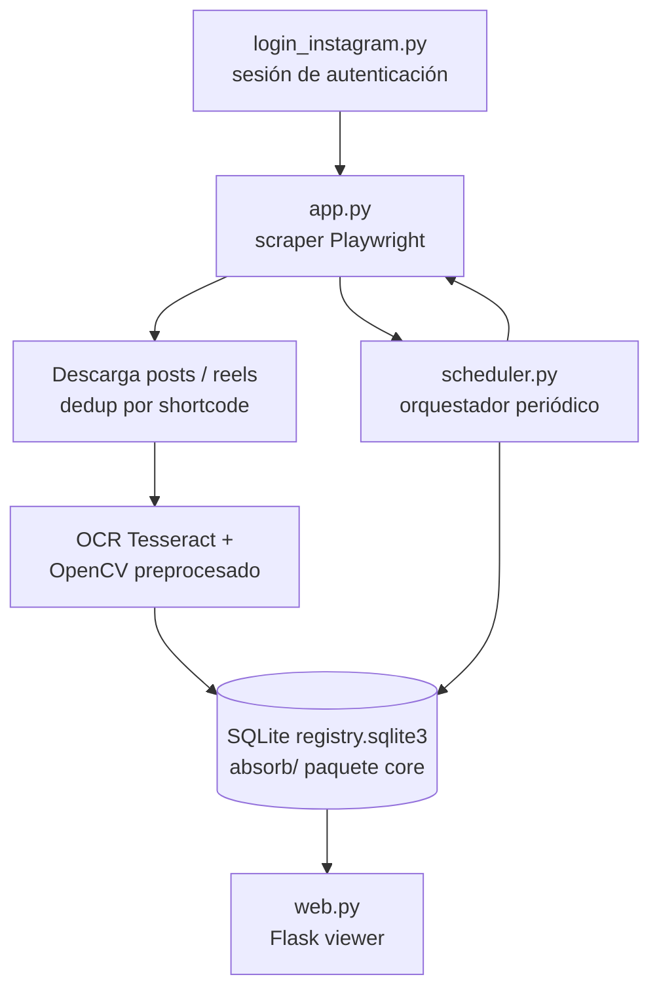

# absorb

Scraper de Instagram con OCR en español. Automatiza la navegación de perfiles, descarga posts y reels, ejecuta OCR (Tesseract) sobre las imágenes, persiste los resultados en SQLite y los expone en un visor web con scheduler periódico.

[](https://github.com/bi0punk/absorb/actions/workflows/ci.yml)
[](https://www.python.org/)
[](LICENSE)

## Contenido

- [Características](#características)
- [Arquitectura](#arquitectura)
- [Stack](#stack)
- [Estructura del repositorio](#estructura-del-repositorio)
- [Instalación](#instalación)
- [Uso](#uso)
- [Configuración](#configuración)
- [Tests / CI](#tests--ci)
- [Roadmap](#roadmap)
- [Licencia](#licencia)

## Características

- Scraping de perfiles/reels de Instagram vía Playwright (navegación por flecha nativa).
- Descarga de posts (imágenes/video) con reintentos y deduplicación por shortcode.
- OCR en español (Tesseract) con preprocesamiento OpenCV.
- Persistencia en SQLite (registro de posts + state por fuente).
- Web viewer Flask para navegar resultados.
- Scheduler periódico (configurable por fuente) con zonas horarias.

## Arquitectura



El paquete core `absorb/` (sources, dates, registry, state, utils, constants) es Python puro (sqlite3/json/re), sin dependencias pesadas, lo que permite probarlo en CI sin Playwright ni Tesseract.

## Stack

- **Lenguaje**: Python 3.12+
- **Scraping**: Playwright (Chromium)
- **OCR**: pytesseract + opencv-python (preprocesamiento)
- **Web**: Flask + Jinja2
- **DB**: SQLite
- **Auth**: `login_instagram.py` (helper de login con Playwright)
- **Calidad**: ruff (lint), pytest

## Estructura del repositorio

```
absorb/
├── app.py                   # Scraper principal (Playwright + OCR)
├── web.py                   # Flask viewer
├── scheduler.py             # Orquestador periódico
├── login_instagram.py       # Helper de autenticación
├── absorb/                  # Paquete core (Python puro)
│   ├── sources.py
│   ├── dates.py
│   ├── registry.py
│   ├── state.py
│   ├── utils.py
│   └── constants.py
├── templates/               # Vistas Jinja2 (base, index, detail, login)
├── tests/                   # 120 tests (sources, dates, registry, state)
├── requirements.txt
├── pyproject.toml
└── .github/workflows/ci.yml
```

## Instalación

Requisitos: Python 3.12+, Chromium (vía `playwright install chromium`) y Tesseract OCR (`tesseract-ocr` + datos `spa`).

```bash
python3 -m venv .venv
source .venv/bin/activate
pip install -r requirements.txt
playwright install chromium
# Tesseract (Debian/Ubuntu):
sudo apt-get install -y tesseract-ocr tesseract-ocr-spa
```

## Uso

```bash
# Login interactivo (guarda sesión en data_instagram/)
python login_instagram.py

# Scraper (ver --help para opciones de fecha/fuentes)
python app.py <profile_url> [--date-from YYYY-MM-DD] [--until YYYY-MM-DD]

# Web viewer
python web.py

# Scheduler periódico (config en data_instagram/scheduler.json)
python scheduler.py
```

## Configuración

Variables de entorno reales (definidas en `app.py`):

| Variable | Default | Descripción |
|---|---|---|
| `SCRAPER_DELAY_FACTOR` | `0.7` | Factor de retardo entre acciones (0.15–3.0) |
| `SCRAPER_BEHAVIOR_PROFILE` | `balanced` | Perfil de comportamiento de navegación |
| `SCRAPER_HEADLESS` | off | `1` ejecuta el browser invisible (scheduler/CI) |
| `SCRAPER_RUN_CONTEXT` | — | `scheduler` marca una ejecución desde scheduler |

Los artefactos runtime (`data_instagram/`): SQLite registry, estado por fuente, posts descargados, análisis OCR, sesión de login y config del scheduler. Todo el directorio está en `.gitignore`.

## Tests / CI

```bash
pytest -q
```

120 tests cubren el paquete `absorb/` (sources, dates, registry, state), con SQLite efímera y `tmp_path`; no requieren Playwright/OCR/DB externa.

CI: GitHub Actions (`.github/workflows/ci.yml`) sobre Python 3.12: **lint** (`ruff check .`) y **test** (`pytest -q`, sin Playwright/Tesseract/Chromium).

## Roadmap

- [x] Scraping de perfiles y reels con deduplicación por shortcode
- [x] OCR en español con preprocesamiento OpenCV
- [x] Persistencia SQLite + web viewer + scheduler
- [ ] Tests del scraper con fixtures HTML (end-to-end)
- [ ] Exportación CSV/JSON
- [ ] Dashboard de métricas

Limitación conocida: depende del DOM de Instagram (frágil a cambios de la plataforma).

## Licencia

MIT — ver [LICENSE](LICENSE).